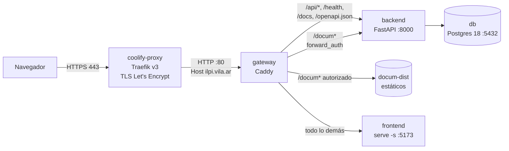
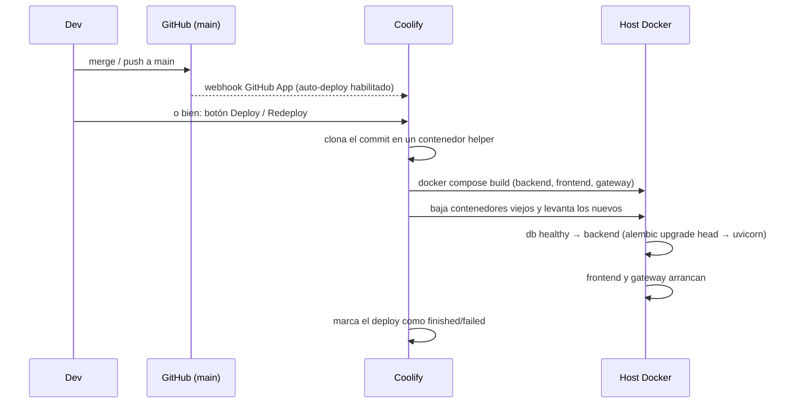

# Infraestructura de producción — VPS + Coolify

Cómo corre ILPI en producción: **https://ilpi.vila.ar**, desplegado con **Coolify** en el
VPS propio `62.238.61.134`. En vigor desde el **2026-10-27**; antes corría en Railway
(ver [Historial](#historial)).

> Los valores marcados con ⚠️ **No verificado** son supuestos que todavía no se
> comprobaron en el servidor.

---

## 1. Resumen

| Elemento | Valor |
|---|---|
| URL pública | https://ilpi.vila.ar |
| VPS | `62.238.61.134` — Ubuntu 24.04.1, 4 vCPU, 7.6 GB RAM, 75 GB disco, Docker 27.5 |
| Acceso SSH | `ssh root@62.238.61.134` (clave del usuario) |
| Panel Coolify | https://panel.vila.ar (Coolify 4.4.6) |
| Proyecto / entorno Coolify | `ILPI` / `production` |
| Recurso Coolify | `ilpi-resto` — uuid `9poetcpgivmo9yhrf4ldd765` (id interno `8`) |
| Origen del código | GitHub App `coolify-feder102` → `feder102/ilpi-resto`, rama `main` |
| Build pack | **Docker Compose** → `/docker-compose.coolify.yml` |
| DNS | Hetzner DNS (zona `vila.ar`): registro **A** `ilpi` → `62.238.61.134` |
| TLS | Let's Encrypt emitido por el Traefik de Coolify (renovación automática) |
| Base de datos | Postgres **18** dentro del mismo stack (no expuesta a Internet) |

**Vecinos:** en el mismo VPS corren otras apps de otros proyectos (`rafa`, `clara`, `fede`,
`landing`, `maxilofacial`, `armatuequipo` `.vila.ar`) y la propia base de Coolify.
**No tocarlas.** Todo lo de ILPI se identifica por el sufijo `9poetcpgivmo9yhrf4ldd765`.

---

## 2. Cómo viaja un request



1. **Traefik** (`coolify-proxy`, compartido por todas las apps del VPS) termina TLS y,
   por el host `ilpi.vila.ar`, manda el tráfico al servicio `gateway` en el puerto 80.
   El HTTP plano se redirige a HTTPS.
2. **gateway** (Caddy, `gateway/Caddyfile`) reparte por path bajo **un único dominio**.
   Front y back comparten origen, así que no hay CORS ni cookies cross-site
   (`COOKIE_SAMESITE=lax`, `COOKIE_SECURE=true`).
3. **backend** corre `alembic upgrade head` y después uvicorn con `--proxy-headers`,
   para que el rate limiting y la auditoría vean la **IP real del visitante**. Caddy
   confía en el `X-Forwarded-For` que llega de redes privadas.
4. **frontend** es la SPA compilada (`VITE_API_URL=/api/v1`, relativo), servida por `serve -s`.
5. **/docum** es el sitio de documentación, **solo para Admin**: Caddy consulta
   `/api/v1/docum/authorize`, que responde 2xx (sirve), 303 (al login) o 403.

---

## 3. Servicios del stack (`docker-compose.coolify.yml`)

| Servicio | Imagen / build | Puerto interno | Healthcheck | Notas |
|---|---|---|---|---|
| `db` | `postgres:18` | 5432 | `pg_isready` | Volumen `ilpi-pgdata18` montado en `/var/lib/postgresql` |
| `backend` | `./backend/Dockerfile` | 8000 | `GET /health` | Migraciones al arrancar; scheduler activo (job diario 01:00) |
| `frontend` | `./frontend/Dockerfile` (target `production`) | 5173 | — | SPA estática |
| `gateway` | `./gateway/Dockerfile` (Caddy 2) | 80 | — | **Único servicio con dominio** en Coolify |

En el host, los contenedores se llaman `<servicio>-9poetcpgivmo9yhrf4ldd765-<timestamp>`.
El timestamp cambia en cada deploy.

**Volúmenes Docker** (prefijo `9poetcpgivmo9yhrf4ldd765_`):

| Volumen | Contenido |
|---|---|
| `ilpi-pgdata18` | **Datos de producción** (Postgres 18). No borrar. |
| `ilpi-caddy-data` | Estado interno de Caddy (sin certificados: TLS lo maneja Traefik) |

**Directorio de la app en el host:** `/data/coolify/applications/9poetcpgivmo9yhrf4ldd765/`
(`docker-compose.yaml` generado por Coolify, `.env`, `docum-dist/` con el sitio de `/docum`).

> ⚠️ **Coolify no deja el checkout del repo en el host.** Un bind-mount de un archivo del
> repo (`./algo.conf:/ruta`) termina como un **directorio vacío** y el contenedor no arranca.
> Por eso el Caddyfile se copia dentro de la imagen (`gateway/Dockerfile`). Los
> bind-mounts de directorios (`./docum-dist`) sí funcionan: Coolify crea el directorio
> vacío en el host y su contenido **se mantiene entre deploys**.

---

## 4. Variables de entorno y secretos

Viven en Coolify → recurso → *Environment Variables*. Nunca en el repo.

| Variable | Origen | Uso |
|---|---|---|
| `DOMAIN` | Manual: `ilpi.vila.ar` | `CORS_ORIGINS=https://$DOMAIN` |
| `SERVICE_PASSWORD_POSTGRES` | **Generada por Coolify** | Contraseña de Postgres y `DATABASE_URL` |
| `SERVICE_PASSWORD_64_SECRETKEY` | **Generada por Coolify** | `SECRET_KEY` (firma de JWT) |
| `SERVICE_FQDN_GATEWAY`, `SERVICE_URL_GATEWAY` | Generadas por Coolify | A partir del dominio del gateway (no se usan en el código) |
| `POSTGRES_USER` / `POSTGRES_DB` | Default `ilpi` / `ilpi` | |
| `LOG_LEVEL` | Default `INFO` | |
| `MAILJET_API_KEY`, `MAILJET_SECRET_KEY`, `MAILJET_SENDER_NAME`, `MAILJET_SENDER_EMAIL` | Manual, opcionales | Envío de emails. ⚠️ **No verificado:** hoy están vacías, así que el envío real de mails no está configurado. |

- Cambiar `SERVICE_PASSWORD_64_SECRETKEY` **invalida todas las sesiones**.
- **No cambies `SERVICE_PASSWORD_POSTGRES` desde Coolify:** Postgres solo lee la contraseña
  al crear el volumen. Si cambia la variable pero no la base, el backend no puede conectarse.
  Para rotarla primero hay que hacer `ALTER USER ilpi PASSWORD '…'` dentro de la base.

---

## 5. Cómo se despliega



- **Duración:** ~1 a 1,5 minutos. Mientras se recrean los contenedores, el dominio puede
  devolver **503 "no available server"** durante unos segundos. Es esperable.
- **Auto-deploy:** está habilitado en Coolify (`is_auto_deploy_enabled = true`).
  ⚠️ **No verificado** que el push a `main` lo dispare: en la otra app del VPS
  (`taller_sillero`) el webhook no funcionó y hubo que deployar a mano. Si después de
  un merge no aparece un deploy nuevo, apretar **Deploy** en el panel.
- **Cambios en el compose** (`docker-compose.coolify.yml`): antes del deploy apretar
  **Reload Compose** en *General*, para que Coolify relea el archivo y sus variables.
- **Migraciones:** automáticas en cada arranque del backend. Las que sean destructivas
  deben ser reversibles, porque se aplican directo contra producción.
- **Rollback:** Coolify → recurso → *Rollback* (imágenes de commits anteriores). Ojo: una
  migración ya aplicada **no se revierte sola**.

### Consultar el estado de un deploy por SSH (solo lectura)

```bash
docker exec coolify-db psql -U coolify -d coolify -c \
  "select id,status,commit,created_at from application_deployment_queues
   where application_id='8' order by id desc limit 5;"
```

---

## 6. Operación diaria

Todos los comandos se corren en el VPS (`ssh root@62.238.61.134`). Como los nombres de
contenedor cambian en cada deploy, conviene definir estos atajos primero:

```bash
APP=9poetcpgivmo9yhrf4ldd765
DB=$(docker ps -q --filter name=db-$APP)
BE=$(docker ps -q --filter name=backend-$APP)
```

| Tarea | Cómo |
|---|---|
| Ver estado | `docker ps --filter name=$APP` |
| Logs del backend | Coolify → *Runtime Logs*, o `docker logs -f --tail 100 $BE` (JSON estructurado) |
| Health | `curl https://ilpi.vila.ar/health` → `{"status":"ok"}` |
| Consola SQL | `docker exec -it $DB psql -U ilpi -d ilpi` |
| Shell del backend | Coolify → *Terminal*, o `docker exec -it $BE sh` |
| Seed (solo base vacía) | `docker exec $BE python -m app.seed` → cambiar después la contraseña del admin |
| Reiniciar | Coolify → *Restart* (no reconstruye), o *Redeploy* (reconstruye) |

### Backups

> ⚠️ **Hoy no hay backups automáticos de la base de ILPI.** Los backups programados de
> Coolify solo cubren las bases "standalone" (`coolify-db` y otra de otro proyecto), no las
> que viven dentro de un recurso Docker Compose.

Backup manual (formato custom, comprimido):

```bash
mkdir -p /root/ilpi-backups && chmod 700 /root/ilpi-backups
docker exec $DB pg_dump -U ilpi -d ilpi -Fc > /root/ilpi-backups/ilpi-$(date +%F).dump
```

Pendiente: automatizarlo con un cron en el host o una *Scheduled Task* de Coolify, y
sacar las copias del VPS (por ejemplo a S3 o al Storage Box de Hetzner).

### Restaurar un dump

```bash
docker stop $BE
docker exec $DB psql -U ilpi -d ilpi -c "DROP SCHEMA public CASCADE; CREATE SCHEMA public;"
docker exec -i $DB pg_restore -U ilpi -d ilpi --no-owner --no-privileges --exit-on-error < archivo.dump
docker start $BE        # al arrancar aplica las migraciones que falten
```

El dump debe salir de un `pg_dump` con versión **igual o menor** a 18.

### Publicar el sitio de documentación (`/docum`)

El contenido sale de `docs/architecture/site/{types,data}.ts` y se renderiza con el
proyecto [template-documentacion](https://github.com/feder102/template-documentacion).
Desde la raíz del repo, en una máquina con Node y SSH al VPS:

```bash
scripts/build-docum.sh              # build + rsync al VPS
scripts/build-docum.sh --no-upload  # solo build, en ./docum-dist (ignorado por git)
```

El script clona el template en un directorio temporal (`TEMPLATE_REF`, por defecto
`main`), copia los dos archivos, compila con `vite build --base=/docum/` y sincroniza
`dist/` en `/data/coolify/applications/9poetcpgivmo9yhrf4ldd765/docum-dist/`
con `rsync --delete`. **No hace falta redeploy**: Caddy sirve el directorio montado.

> El template guarda los artículos en el `localStorage` del navegador
> (`sunset_docs_articles`). Quien ya abrió `/docum` va a seguir viendo la versión
> anterior hasta que borre los datos del sitio.

---

## 7. Solución de problemas

| Síntoma | Causa probable | Qué hacer |
|---|---|---|
| `no available server` (503) | Deploy en curso, o el `gateway` caído | Esperar a que termine el deploy; si no, revisar `docker ps --filter name=$APP` y los logs |
| El dominio no abre en una sola máquina, pero sí en otras | **Caché DNS negativa**: se consultó el dominio antes de que existiera el registro (Hetzner la guarda hasta 1 h) | `sudo dscacheutil -flushcache; sudo killall -HUP mDNSResponder` (macOS), reiniciar el router o usar DNS `1.1.1.1` |
| Error en el deploy: `error mounting … create mountpoint` | Bind-mount de un **archivo** del repo (ver §3) | Copiar el archivo dentro de una imagen (`COPY`) |
| El backend reinicia en loop | Falla una migración o la base no responde | Revisar `docker logs $BE`: la primera línea con error suele ser de alembic |
| Login OK pero se pierde la sesión a los 30 min | Cookie `refresh_token` no aceptada | Confirmar que se entra por `https://ilpi.vila.ar` (mismo origen) y que `COOKIE_SECURE=true` |
| Todos los usuarios reciben 429 en el login | El backend ve una sola IP para todos | Confirmar `--proxy-headers` en el comando del backend y `trusted_proxies` en el Caddyfile |
| `/docum` muestra un error o una página vacía siendo Admin | `docum-dist/` vacío en el host | `scripts/build-docum.sh` |
| `/docum` no muestra artículos nuevos | El template cachea los artículos en `localStorage` | Borrar los datos del sitio en el navegador |

---

## 8. Seguridad

- Postgres **no publica puertos**: solo se llega por la red interna del stack.
- Los únicos puertos públicos del VPS son 80/443 (Traefik) y 22 (SSH).
  ⚠️ **No verificado:** el firewall del VPS. `ufw` no está instalado; habría que revisar
  si hay un Cloud Firewall en el panel de Hetzner.
- Los secretos los genera Coolify y se guardan cifrados en su base. No están en el repo
  ni en `.env` versionados.
- Headers de seguridad, CORS y rate limiting siguen viniendo del backend (ver
  `backend/README.md`).

---

## Historial

| Fecha | Cambio |
|---|---|
| 2026-10-27 | Migración desde **Railway** (proyecto `registro-empleados-ilpi`, Postgres 18): `pg_dump` desde el VPS, restauración en `ilpi-pgdata18` y conteos verificados tabla por tabla (14 tablas). Respaldo del dump original en `/root/ilpi-migration/railway-2026-10-27.dump`. |
| 2026-10-27 | Primer deploy en Coolify (PR #81). El stack pasó de Postgres 16 a 18 para igualar la versión de Railway; se borró el volumen residual de PG16 (`ilpi-pgdata`). |
| 2026-10-27 | `/docum` publicado con `scripts/build-docum.sh`, incluida la nueva categoría **Infraestructura**. |

### Pendientes conocidos
- [ ] Backups automáticos de la base, fuera del VPS.
- [ ] Verificar que el auto-deploy por webhook funciona.
- [ ] Apagar o eliminar Postgres en Railway y rotar su contraseña.
- [ ] Revisar el firewall del VPS.
